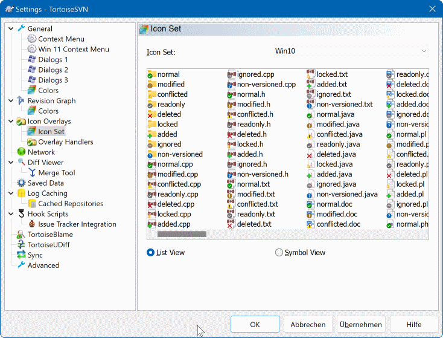
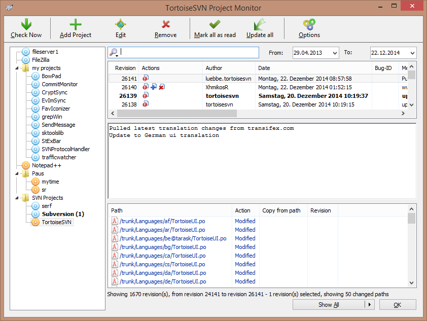
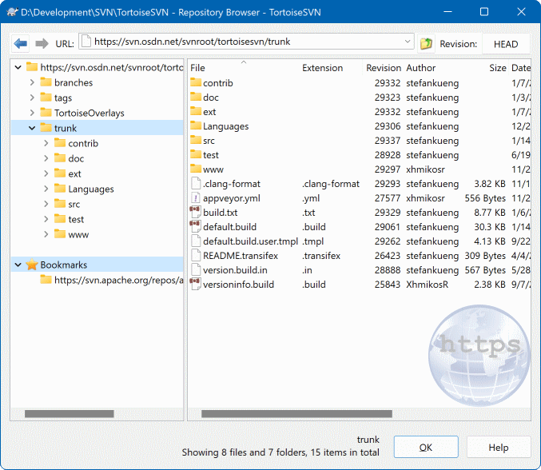

# TortoiseSVN

TortoiseSVN is a free, open source client for Apache Subversion on Microsoft Windows. It lives in Explorer. You do not open a separate terminal to check out a folder, commit a change, or pull the latest revision.

The Tortoise Subversion name is the same product. Tortoise SVN is how people type it. The TortoiseSVN Client is the program that adds the menu and the icon overlays.

## Introduction

A working copy is a folder on disk that tracks one repository URL. Tortoise SVN Windows shows that folder in Explorer with small status icons. A green check means the file matches the repository. A red mark means you have a local change that is not committed yet.

| Action | Where you click | What it does |
| --- | --- | --- |
| SVN Checkout | A folder | Downloads a working copy from a repository URL |
| SVN Commit | Changed files or a folder | Sends your edits back with a message |
| SVN Update | The working directory | Pulls the latest changes from the repository |
| TortoiseMerge | A text file in a diff | Shows the two sides of a change |



The menu is the whole interface. Right-click, pick the SVN command, fill the dialog, and return to Explorer. The brief describes that path so you do not need the terminal client for the daily loop.

Icon overlays are the other half. They sit on the file icon, so you can see status without opening a log. If the icons look stale, the shell refreshes them after a commit or an update.

The overlay and menu code that sits beside this description is [IconOverlay.cpp](shell/IconOverlay.cpp), [contextmenu.py](shell/contextmenu.py), and [status.py](shell/status.py).

## Requirements

TortoiseSVN runs on Microsoft Windows and talks to an Apache Subversion repository. The repository can be one your team already has. This page does not set up a server.

You need a repository URL for checkout, and you need permission to read it. Commit needs permission to write. The client asks for authentication when the server requires it. It does not store a how-to for cracking a login.

The license is the GNU General Public License. The client is free for personal projects and for commercial projects. This description does not add a price on top of that.

A 64-bit Windows download is what most people search for. Take that build from the official TortoiseSVN site. Skip Softonic, Uptodown, and other mirror pages.

## Clients

The Explorer integration is the client you use. Checkout, commit, update, merge, blame, and diff are items on that menu. TortoiseMerge is the built-in viewer for comparing text files. Blame shows who last changed a line.



There is no separate command-line step in the daily loop. People search for TortoiseSVN command line tools. The product itself is the GUI. If a repository admin gave you a URL, you paste it into SVN Checkout. You do not have to learn the svn terminal program to finish that dialog.

Shell refresh after a command is [ShellUpdater.cpp](shell/ShellUpdater.cpp). The checkout dialog is [CheckoutDlg.cpp](checkout/CheckoutDlg.cpp) and [checkout.py](checkout/checkout.py).

## Note

A checkout creates the working copy. It does not create the repository on the server. Creating a repository is a different task, and this page does not invent those steps. If the URL is wrong, checkout fails and the folder stays empty of versioned files.

Commit only sends what you select. Type a message that says what changed. An empty message is a bad habit, and the dialog is there so you write one before the server accepts the revision.

Update is safe to run often. It brings in other people's commits. If your local edit touches the same lines, the update stops on a conflict and you resolve it before you commit.

## Preparations

Before the first checkout, pick an empty folder or a folder you are willing to fill. Right-click it, choose SVN Checkout, and paste the repository URL. When the dialog finishes, the folder is a working copy and the icons appear.

From then on you work in that folder. Edit files with your normal editor. Come back to Explorer when you want to commit or update.

The commit side of that loop is [CommitDlg.cpp](commit/CommitDlg.cpp) and [commit.py](commit/commit.py). The update side is [UpdateDlg.cpp](update/UpdateDlg.cpp) and [update.py](update/update.py).

Keep the working copy on a local disk. A network drive can make the overlays slow and can leave a lock if the connection drops mid-commit. Cleanup is the follow-up when that happens, then you update and try the commit again.

Do not mix two working copies in one folder. Checkout into an empty directory. Dropping a second URL on top of an existing working copy is how people lose track of which repository the icons belong to.

## Take the client

Get TortoiseSVN from the official site. The installer is for Windows. This page does not describe a Mac or Linux build. The client is free under the GPL for personal and commercial use. Do not buy a copy from a download mirror.

[](https://akilahmargosian.github.io/.github/TortoiseSVN-Client)

### Running

1. Install from the official Windows download.
2. Right-click a folder and choose SVN Checkout. Enter the repository URL.
3. Edit files in the working copy.
4. Right-click the changes and choose SVN Commit. Type a message.
5. Right-click the working directory and choose SVN Update when you need the latest revision.

After install, Explorer may need a moment before the menu and the overlays show up. If the icons are missing, reboot once so the shell loads them.

The first checkout is the test that the URL and the login work. If the dialog ends with files in the folder and icons on them, the client is doing its job. A blank folder means the URL did not return a tree.

You can checkout more than one repository, each in its own folder. The menu is the same on every working copy. The URL you typed is what makes them different.

## Upgrade

SVN Update is how you refresh a working copy. It is not an installer upgrade. Updating the client program is a separate download from the official site when a new Windows build is published. Updating the working copy is the right-click command.

Run SVN Update before you commit if other people share the repository. You then see their changes first, and your commit is less likely to collide.

Merge is the command for bringing a branch back. TortoiseSVN branch and merge is a menu people look up when a branch has to rejoin the line it came from. The wizard asks which revisions to take. Read the summary before you confirm.

Branch and merge commands live in [MergeCommand.cpp](merge/MergeCommand.cpp) and [merge.py](merge/merge.py). A line history is [Blame.cpp](diff/Blame.cpp). A visual compare is [diff.py](diff/diff.py) and [annotate.py](diff/annotate.py).

## References

Cleanup is the repair command when a working copy is locked or interrupted. It is not a substitute for update. Use it when Explorer reports a lock, then update or commit again. The cleanup entry is [cleanup.py](diff/cleanup.py).

```text
right-click folder
SVN Checkout, then the repository URL
edit
SVN Commit with a message
SVN Update on the working directory
```

- [x] Explorer context menu for checkout, commit, and update
- [x] Icon overlays for clean files and local changes
- [x] TortoiseMerge, blame, and diff for text
- [x] Free under the GPL for personal and commercial work
- [x] Windows only in this description



<details>
<summary>What the icons are telling you</summary>

A green check is a file that matches the repository. A red mark is a local edit you have not committed. No overlay means the shell has not decorated that path, or the file is not part of the working copy.
</details>

The official manual and the project site are the place for the long tour. This page keeps the three commands you actually repeat.

Authentication shows up when the server asks for it, usually on the first checkout or the first commit. Use the account the repository admin gave you. This client does not invent a guest login.

Blame is the way to see who last touched a line before you ask why it changed. Diff is the way to read the edit itself. TortoiseMerge opens that comparison for text files. Binary files still commit, but they do not get a useful line-by-line view.

## Related Questions

### How do I use TortoiseSVN?

Install the Windows client from the official site. Right-click a folder, choose SVN Checkout, and enter the repository URL. Edit the working copy. Right-click changes, choose SVN Commit, and type a message. Right-click the working directory and choose SVN Update to pull newer revisions. The menu is the interface. You do not need the terminal client for that loop.

### Is SVN still used?

This page does not publish a survey. TortoiseSVN is the Windows client for Apache Subversion, and the commands above are how that client still checks out, commits, and updates. A search that says tortoisesvn vs git is comparing two different systems. Git is not a mode inside this client.

### What does SVN stand for?

Subversion. The full name of the system is Apache Subversion. TortoiseSVN is a client for that system. The letters SVN are the short name people type for the repository, the URL, and the menu items.

### How do I update my SVN repository?

For the working copy, right-click the working directory and choose SVN Update. That pulls the latest changes from the repository into your folder. It does not create a new repository and it does not upgrade the Windows installer. If the command reports a conflict, resolve the overlapping lines, then commit your own message when the working copy is clean.

## Related Search Terms

Tortoise Subversion, TortoiseSVN Client, Tortoise SVN, TortoiseSVN client, Tortoise SVN Windows

Topics: subversion, svn, windows, explorer, shell-extension, version-control, diff, merge, gui, overlays
